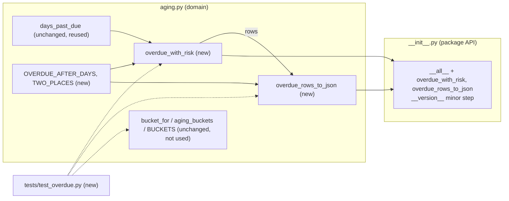

# task.components: FEAT-ZD-48600

Components and layers the Backend lane creates or updates for FEAT-ZD-48600 (ZD-48600, "Show which overdue invoices belong to vendors that usually pay late"), with the smallest change that meets the design. This is step BE-04. There is no gate: automated checks, the independent judge and sampled human evaluation review it (record:brief).

Statements marked **agent judgement** are this agent's reading of the code and inputs; no input states them as fact.

| Field | Value | Source |
|---|---|---|
| Trace ID | FEAT-ZD-48600 | record:brief |
| Step | BE-04 Identify the components/layers to be changed (attempt 1) | record:brief |
| Inputs | feat.tasks (b0fd4d2), feat.stories (0590ea4), feat.prd (908b58d), feat.trd (3637e51), feat.design (722a98f), task.repo_access (aac590a) | record:brief |
| Backend tasks | TSK-05 (STORY-05, size M) and TSK-06 (STORY-06, size S), both in ap_aging | feat.tasks (section 1); task.repo_access (section 1) |
| Repository | ap_aging, Python 3.9 standard library, branch `feature/story` at `5d2cbb9`, working tree clean | task.repo_access (section 2); file:ap_aging/CLAUDE.md |
| Code read | `src/ap_aging/__init__.py`, `src/ap_aging/aging.py`, `tests/test_aging.py`, `tests/__init__.py`, `ci.py`, `README.md`, `CLAUDE.md` | tool:repo; file:ap_aging/ci.py; file:ap_aging/README.md; file:ap_aging/CLAUDE.md |
| Result | **Two source files updated, one test file created. Nothing else changes.** No new module, layer, dependency, storage or transport | sections 2 to 4 |

## 1. What the existing code is

ap_aging is a single-module library. It has no service or transport layer (feat.design A3 "Transport for CT-1"; feat.trd R-7), no database (task.repo_access section 2), and no configuration file: the repository holds only `src/ap_aging/__init__.py`, `src/ap_aging/aging.py`, `tests/`, `ci.py`, `README.md` and `CLAUDE.md` (tool:repo; file:ap_aging/ci.py; file:ap_aging/README.md).

| Layer | File | What it holds today | Source |
|---|---|---|---|
| Package API | `src/ap_aging/__init__.py` | `from .aging import aging_buckets`; `__version__ = "1.4.0"`; `__all__ = ["aging_buckets"]` | tool:repo |
| Domain logic | `src/ap_aging/aging.py` | `BUCKETS`; `days_past_due(due_date, as_of)` = `max((as_of - due_date).days, 0)`; `bucket_for(days)`; `aging_buckets(invoices, as_of)`, which skips `inv.get("paid")` and sums `Decimal(inv["amount"])` per bucket. Imports: `date`, `Decimal`, `Dict`, `Iterable` | tool:repo |
| Unit tests | `tests/test_aging.py` | `test_days_past_due`, `test_bucket_edges`, `test_aging_buckets_skips_paid`, with `AS_OF = date(2026, 10, 25)` | tool:repo |
| CI | `ci.py` | Compile, unittest discovery in `tests/`, coverage of `src/ap_aging` with `COVERAGE_MIN = 90.0`, static checks (no `print`, `eval`, `exec`, no bare `except`, lines at most 140 characters) on every `src/ap_aging/*.py` | file:ap_aging/ci.py |
| Docs | `README.md` | One-line description and the CI command; it lists no functions | file:ap_aging/README.md |

Two facts in the code shape the change:

- `bucket_for(30)` returns `"31-60"` because the `"1-30"` branch is `days < 30`. The new overdue rule must not reuse `bucket_for`, or an invoice exactly 30 days past due would be listed (tool:repo; feat.trd F-10, IF-5.3; feat.design DD-4).
- `days_past_due` already gives calendar days after the due date, floored at 0, and `aging_buckets` already uses `inv.get("paid")` for the paid test. Both can be reused as they are (tool:repo; feat.trd IF-5.1, IF-5.2; record:memory D-2026-031, D-2026-050).

## 2. Components to change

| # | Component | Layer | Change | Task / story | Design | Source |
|---|---|---|---|---|---|---|
| CMP-1 | `OVERDUE_AFTER_DAYS = 30` in `aging.py` | Domain | **New** module constant | TSK-05 / STORY-05 | HC-6; B3.2; DD-4 | feat.design (B3.1, B3.2); feat.tasks (TSK-05) |
| CMP-2 | `TWO_PLACES = Decimal("0.01")` in `aging.py` | Domain | **New** module constant, shared by CMP-3 and CMP-4 | TSK-05 / STORY-05 | B3.2; DD-10 | feat.design (B3.2); feat.tasks (TSK-05) |
| CMP-3 | `overdue_with_risk(invoices: Iterable[Dict], as_of: date, risk_by_vendor: Dict[str, str]) -> List[Dict]` in `aging.py` | Domain | **New** pure function | TSK-05 / STORY-05 | HC-6; IF-5 | feat.design (B3.2); feat.trd (IF-5.1 to IF-5.8); feat.tasks (TSK-05) |
| CMP-4 | `overdue_rows_to_json(rows: Iterable[Dict]) -> str` in `aging.py` | Domain (serialisation to CT-1) | **New** pure function | TSK-06 / STORY-06 | HC-7; CT-1; DD-3 | feat.design (A3, B3.2); feat.trd (IF-6); feat.tasks (TSK-06) |
| CMP-5 | Imports in `aging.py` | Domain | **Updated**: add `import json`; extend the existing `from typing import Dict, Iterable` line with `List` | TSK-05 (`List`), TSK-06 (`json`) | B3.1 | feat.design (B3.1); feat.tasks (TSK-05, TSK-06); tool:repo |
| CMP-6 | `src/ap_aging/__init__.py` | Package API | **Updated**: import and add `overdue_with_risk` and `overdue_rows_to_json` to `__all__`; one minor version step from `1.4.0` | TSK-05 (export, version), TSK-06 (export) | B3.1; DD-11 | feat.design (B3.1, DD-11); feat.tasks (section 2, TSK-05, TSK-06); task.repo_access (section 3) |
| CMP-7 | `tests/test_overdue.py` | Unit tests | **New** file | TSK-05, TSK-06 | B3.5 | feat.tasks (section 2, TSK-05, TSK-06); feat.design (B3.5) |

Sources: feat.design (A2 HC-6, HC-7; B3.1 to B3.5); feat.tasks (TSK-05, TSK-06); feat.trd (C-6, C-7).

## 3. Components that do not change

| Component | Why it stays | Source |
|---|---|---|
| `BUCKETS`, `days_past_due`, `bucket_for`, `aging_buckets` | "Must not change"; existing signatures kept; T-11 regression | feat.tasks (TSK-05); feat.trd (IF-5.8, T-11); file:ap_aging/CLAUDE.md |
| `tests/test_aging.py` | Existing functions must return the same results as today (AC-05.9), so their tests stay as they are (agent judgement); new tests go to `tests/test_overdue.py` "to limit merge conflicts between parallel tasks" | feat.tasks (section 2); feat.stories (AC-05.9) |
| `ci.py` | The coverage source (`src/ap_aging`) and static checks already cover the new code; no CI change is needed | file:ap_aging/ci.py |
| `README.md` | Lists no functions; the new functions carry docstrings instead (agent judgement) | file:ap_aging/README.md |
| Transport, service or API layer | None exists and none is added; adding one would re-trigger DES-01 | feat.design (A3, DD-3, A8); feat.tasks (TSK-06 "Must not change") |
| Database, storage, configuration, secrets | No repository uses a database; functions are pure and in-memory | task.repo_access (section 2); feat.design (NF-10) |
| Other repositories (ap_pipeline, ap_forecast, ap_portal) | Other lanes; ap_aging builds against DC-1, DC-3 and CT-1, not their code | feat.design (A3, Part C "Lane dependencies"); task.repo_access (section 1) |

## 4. Minimum-change design per component

The aim is the fewest new lines that meet AC-05.1 to AC-05.10 and AC-06.1 to AC-06.4, reusing what the module already has (agent judgement within feat.design B3.2).

### CMP-3 `overdue_with_risk` (TSK-05)

| Step | Minimal implementation | Reuse / why no extra code | Source |
|---|---|---|---|
| Paid filter | `if inv.get("paid"): continue` | Same test as `aging_buckets` | feat.trd (IF-5.1); tool:repo; record:memory (D-2026-050) |
| Days | `days = days_past_due(inv["due_date"], as_of)` | Reuses the existing function; no new date arithmetic | feat.trd (IF-5.2); tool:repo; record:memory (D-2026-031) |
| Overdue rule | `if days > OVERDUE_AFTER_DAYS` | Strict `>` excludes exactly 30; never `bucket_for` | feat.trd (IF-5.3); feat.design (DD-4); feat.stories (AC-05.2) |
| Row | `{"id", "vendor", "days", "amount": Decimal(inv["amount"]).quantize(TWO_PLACES), "risk": risk_by_vendor.get(inv["vendor"], "unknown")}` | `Decimal(...)` as in `aging_buckets`; no float | feat.trd (IF-5.4, IF-5.5); feat.design (B3.2); record:memory (D-2026-044, L-011) |
| Missing `vendor` | No explicit check: `inv["vendor"]` raises `KeyError` by itself | No added branch, so no extra line to cover (agent judgement) | feat.trd (IF-5.7); feat.stories (AC-05.10); feat.tasks (TSK-05) |
| Sort | `rows.sort(key=lambda row: (-row["days"], row["id"]))` | One sort; no secondary pass | feat.trd (IF-5.6); feat.design (B3.2, NF-11) |
| `as_of` | Required parameter, no default | — | feat.tasks (TSK-05) |

### CMP-4 `overdue_rows_to_json` (TSK-06)

One `json.dumps` over a list comprehension that builds each object in CT-1 key order: `id`, `vendor`, `days` as `int(r["days"])`, `amount` as `str(Decimal(r["amount"]).quantize(TWO_PLACES))`, `risk`. An empty list gives `'[]'` with no special case. No date field, no float (feat.design B3.2, CT-1; feat.trd IF-6; feat.stories AC-06.1 to AC-06.4; feat.tasks TSK-06).

### CMP-6 `__init__.py`

Extend the existing import line to `from .aging import aging_buckets, overdue_rows_to_json, overdue_with_risk`, add both names to `__all__`, and step `__version__` one minor version from `1.4.0`; the exact next number is for the lane to confirm (feat.design B3.1, DD-11; feat.tasks section 2; tool:repo).

### CMP-7 `tests/test_overdue.py`

Tests named in feat.tasks TSK-05 and TSK-06, with `AS_OF = date(2026, 10, 25)` and due dates built as `AS_OF - timedelta(days=N)` so that `days` is 30, 31, 42 and 75 (feat.tasks TSK-05; feat.design B3.5):

| Test | Covers | Source |
|---|---|---|
| `test_overdue_boundary_30_and_31` | AC-05.1, AC-05.2; L-007 | feat.tasks (TSK-05); feat.design (B3.5); record:memory (L-007) |
| `test_overdue_excludes_paid_and_not_due` | AC-05.3, AC-05.4 | feat.tasks (TSK-05); feat.design (B3.5) |
| `test_overdue_row_keys_and_sort` | AC-05.5, AC-05.6 (tie on 42: `SYN-INV-002` before `SYN-INV-003`) | feat.tasks (TSK-05); feat.design (B3.5) |
| `test_overdue_unknown_risk` | AC-05.7 | feat.tasks (TSK-05); feat.design (B3.5) |
| `test_overdue_amount_quantised` | AC-05.8 (`Decimal("980.5")` → `Decimal("980.50")`) | feat.tasks (TSK-05); feat.design (B3.5) |
| `test_overdue_missing_vendor_raises` | AC-05.10 | feat.tasks (TSK-05); feat.design (B3.5) |
| `test_existing_aging_unchanged` | AC-05.9; pins `bucket_for(30) == "31-60"`, which `tests/test_aging.py` does not test today | feat.tasks (TSK-05); feat.design (B3.5); tool:repo |
| `test_rows_to_json` | AC-06.1 to AC-06.3 (`"1250.00"` for SYN-INV-004, `days` an integer, `[]` for no rows, key order); compare `json.loads` values | feat.tasks (TSK-06); feat.design (B3.5) |

Every line of CMP-3 and CMP-4 is reached by these tests, so the new code does not lower the package coverage below the `COVERAGE_MIN = 90.0` gate (agent judgement; the CI run in the coding steps confirms it) (file:ap_aging/ci.py; feat.tasks section 2).

## 5. Change map

## 6. Build order and commits

| Order | Task | Files | Commit prefix | Source |
|---|---|---|---|---|
| 1 | TSK-05 | `aging.py` (CMP-1, CMP-2, CMP-3, `List` import), `__init__.py` (export, version), `tests/test_overdue.py` | `STORY-05` | feat.tasks (TSK-05, section 2); task.repo_access (section 3) |
| 2 | TSK-06 | `aging.py` (CMP-4, `json` import), `__init__.py` (export), `tests/test_overdue.py` | `STORY-06` | feat.tasks (TSK-06, section 2); feat.stories (section 2) |

Both on `feature/story`, as the interim answer to RAQ-1 (task.repo_access section 5). CI bar for each: compile, tests, coverage of at least 90%, static checks, Python 3.9 syntax only (feat.tasks section 2; file:ap_aging/ci.py).

## 7. Prerequisites and stop conditions

| Item | Status | Source |
|---|---|---|
| Repository and write access | Met | task.repo_access (section 4) |
| Database change | None needed | task.repo_access (section 2) |
| Dependency on other lanes | None in code; DC-1 and DC-3 are plain dicts | feat.design (A3, Part C); feat.tasks (TSK-05) |
| Design or AC ambiguity that stops coding | None. Pending items (PQ-2, TQ-3, TQ-9) have interim answers in the design | feat.stories (section 3); feat.design (D3) |

## 8. Differences between inputs, resolved

| Point | Inputs | Followed | Source |
|---|---|---|---|
| Test file | feat.stories TK-05.2 proposes `tests/test_aging.py` (agent judgement; SA-6 allows a new file); feat.tasks assigns new `tests/test_overdue.py` | `tests/test_overdue.py` (later, task-level input) | feat.stories (TK-05.2, SA-6); feat.tasks (section 2) |
| JSON amount expression | feat.stories TK-06.1: `str(amount.quantize(Decimal("0.01")))`; feat.design: `str(Decimal(r["amount"]).quantize(TWO_PLACES))` | feat.design form; same result for a `Decimal` row, and it also accepts a hand-built row | feat.stories (TK-06.1); feat.design (B3.2); feat.tasks (TSK-06) |

Neither changes behaviour, so neither is a conflict with an approved output.

## 9. Open questions (non-blocking)

| ID | Question | Interim answer | Owner (proposed) |
|---|---|---|---|
| CQB-1 | Exact next version number for ap_aging | One minor step from `1.4.0`, proposed in the coding step for the lane to confirm | Developer |
| CQB-2 | Carried: TQ-3 (CT-1 approval and serialisation owner), TQ-9 (`KeyError` for missing `vendor`), PQ-2 (sort tie-break), DQ-2 (rounding mode), RAQ-1 (one branch for both stories) | Interim answers as in feat.design D3, feat.trd 7.2 and task.repo_access section 5 | Architect / PM / Developer |

No blocking questions.
